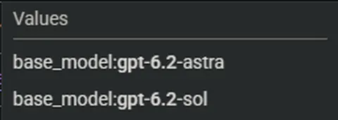
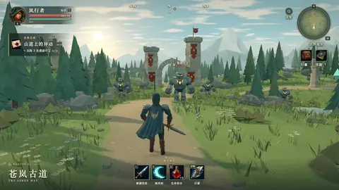
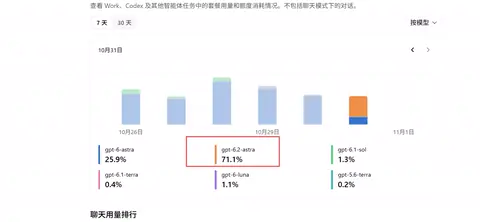

**中文** | [English](README_EN.md)

# GPT-6.2 Preview — GPT-6.2 灰度目击与社区实测索引

追踪 X (Twitter) 上 **GPT-6.2（Astra / Sol）** 的灰度线索与社区实测：配额/用量目击、官方暗示与 3D 游戏演示——链接、提示词与核验状态，一处索引。

> **注意**：截至 2026 年 11 月，GPT-6.2 尚未被 OpenAI 官方发布。以下均为灰度目击与社区报告，模型归属以原帖作者的标注为准，请以原帖为准。
> 本仓库仅做整理与索引；视频类案例的预览为原视频前 5 秒的 WebP 动图，截图类为原图缩略，完整内容请看原帖。原帖与视频版权归各原作者所有。

> 💡 **如何贡献**：在本仓库提交 [Issue](../../issues/new?template=submit_case.yml)（模板会自动带 `submission` 标签），只需粘贴一条推文链接，GitHub Actions 会自动解析、分类并更新本页与 `data/cases.json`。

## 总览表

| 预览 | Part | 标题 | 作者 | 耗时 | 成本 | 时长 | 日期 | 原帖 |
| :--- | :--- | :--- | :--- | :--- | :--- | :--- | :--- | :--- |
|  | — | Astra 与 Sol 双型号现身云端配额 | @lyraxana | — | — | — | 2026-11-05 | [链接](https://x.com/lyraxana/status/2118123296738677133) |
|  | — | Sol 会抢走 Astra 的风头吗 | @ZindanTech | — | — | — | 2026-11-05 | [链接](https://x.com/ZindanTech/status/2118068583775248682) |
|  | — | Tibo 跟进暗示：ChatBLT | @thsottiaux | — | — | — | 2026-11-04 | [链接](https://x.com/thsottiaux/status/2117888243119304945) |
|  | — | Tibo 暗示帖：Le GPT Fat | @thsottiaux | — | — | — | 2026-11-03 | [链接](https://x.com/thsottiaux/status/2117489367417803042) |
|  | — | 一个提示词，一个 3D RPG 世界 | @karanC_12 | — | — | 57.433s | 2026-11-01 | [链接](https://x.com/karanC_12/status/2116895719248536032) |
|  | — | 鹈鹕 360° 立体骑车 | @FiniYang | — | — | 18.0s | 2026-11-01 | [链接](https://x.com/FiniYang/status/2116856735390683281) |
|  | — | Codex 用量记录惊现 GPT-6.2 Astra | @VeknQAQ | — | — | — | 2026-11-01 | [链接](https://x.com/VeknQAQ/status/2116817688215576904) |
## 🧊 3D 与游戏演示 (3D & Game Demos)

| 预览 | 案例名称与摘要 | 技术栈 & 状态 | 原始 Prompt / 链接 |
| :--- | :--- | :--- | :--- |
|  | **一个提示词，一个 3D RPG 世界** KC 分享：单个提示词一键生成半开放世界 3D RPG（视频 57 秒，署名 Fini.Yang），作者标注为 GPT-6.2 Astra 灰度生成，并直接喊话 Opus 5.5。 *By @karanC_12 (2026-11-01)* | 🏷️ 作者标注·未独立验证（Astra 线） | [🔗 原推文](https://x.com/karanC_12/status/2116895719248536032) 

查看 Prompt
<pre>未公开</pre>
 |
|  | **鹈鹕 360° 立体骑车** 作者标注的 GPT-6.2 Astra 灰度测试第一弹：经典「鹈鹕骑自行车」测试被做成可 360° 环视的 3D 场景（视频 18 秒）。 *By @FiniYang (2026-11-01)* | 🏷️ 作者标注·未独立验证（Astra 线） | [🔗 原推文](https://x.com/FiniYang/status/2116856735390683281) 

查看 Prompt
<pre>未公开</pre>
 |
## 🔍 灰度目击 (Gray-rollout Sightings)

| 预览 | 案例名称与摘要 | 技术栈 & 状态 | 原始 Prompt / 链接 |
| :--- | :--- | :--- | :--- |
|  | **Astra 与 Sol 双型号现身云端配额** 截图显示 Google Cloud 配额页同时列出 base_model:gpt-6.2-astra 与 gpt-6.2-sol，是 Sol 型号首个可核对的公开线索。 *By @lyraxana (2026-11-05)* | 🏷️ 灰度目击（未官宣） | [🔗 原推文](https://x.com/lyraxana/status/2118123296738677133) 

查看 Prompt
<pre>未公开</pre>
 |
|  | **Codex 用量记录惊现 GPT-6.2 Astra** 用户翻自己的模型用量时发现 gpt-6.2-astra 条目并截图发帖，是 6.2 灰度最早的目击之一。 *By @VeknQAQ (2026-11-01)* | 🏷️ 灰度目击（未官宣） | [🔗 原推文](https://x.com/VeknQAQ/status/2116817688215576904) 

查看 Prompt
<pre>未公开</pre>
 |
## 📡 信号与讨论 (Signals & Discussion)

| 预览 | 案例名称与摘要 | 技术栈 & 状态 | 原始 Prompt / 链接 |
| :--- | :--- | :--- | :--- |
| 暂无预览 | **Sol 会抢走 Astra 的风头吗** 社区评论：若 Sol 与 Astra 同步发布，接近 Astra 的能力配上低得多的价格，可能让 Sol 成为日常主力——6.1 Sol 已以 1/5 价格提供接近 Astra 的智能。 *By @ZindanTech (2026-11-05)* | 🏷️ 社区讨论 | [🔗 原推文](https://x.com/ZindanTech/status/2118068583775248682) 

查看 Prompt
<pre>未公开</pre>
 |
| 暂无预览 | **Tibo 跟进暗示：ChatBLT** OpenAI 的 Tibo 引用前帖只写下「ChatBLT」，未作任何解释，缩写的解读全部来自社区。 *By @thsottiaux (2026-11-04)* | 🏷️ 官方人员暗示 | [🔗 原推文](https://x.com/thsottiaux/status/2117888243119304945) 

查看 Prompt
<pre>未公开</pre>
 |
| 暂无预览 | **Tibo 暗示帖：Le GPT Fat** OpenAI 的 Tibo 只发了三个词「Le GPT Fat」，没给型号也没给时间，社区普遍将其读作下一代 Astra / Sol 的预告。 *By @thsottiaux (2026-11-03)* | 🏷️ 官方人员暗示 | [🔗 原推文](https://x.com/thsottiaux/status/2117489367417803042) 

查看 Prompt
<pre>未公开</pre>
 |
## 详细记录
### ：一个提示词，一个 3D RPG 世界
- **原帖**：[https://x.com/karanC_12/status/2116895719248536032](https://x.com/karanC_12/status/2116895719248536032) · **时长**：57.433s- **提示词**：未公开
- **亮点**：演示视频署名为 Fini.Yang，KC 转述分享
## 相关资源
- 线索追踪来源：[PayForChat GPT-6.2 追踪页](https://www.payforchat.com/gpt-6-2)（社区线索汇总）
- 同系列项目：[Fable5.5 Preview](https://github.com/zqingdut/fable5.5-preview) — Claude Fable 5.5 实测案例索引

## 说明与版权
- 所有视频与描述均来自各原作者的公开推文，请以原帖为准。
- 本仓库的整理与索引部分以 [MIT License](LICENSE) 发布；索引所指向的原帖内容与视频版权归原作者所有。
- 种子案例为 2026 年 11 月初的首批灰度目击与社区演示帖（见上表），每条均标注核验状态；其中演示类作品由原作者标注为 GPT-6.2 Astra 灰度生成，并非标注为 Sol。
