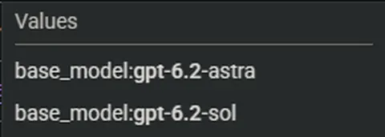
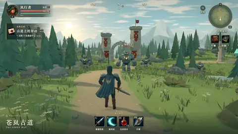
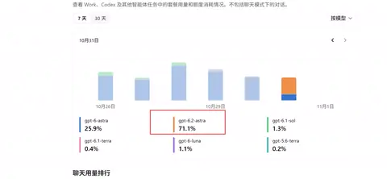

[中文](README.md) | **English**

# GPT6.2 Sol Preview — GPT-6.2 Sol Gray-rollout Sightings & Community Test Index

Tracking the gray-rollout trail of **GPT-6.2 Sol** on X (Twitter): quota/usage sightings, insider signals, and community demos from the same gray wave (including GPT-6.2 Astra) — links, prompts and verification status, all in one place.

> **Note**: As of November 2026, GPT-6.2 Sol has not been officially released by OpenAI. Everything below is gray-rollout sightings and community reports; model attribution follows the original authors' labels — please refer to the original posts.
> This repository is an index only. Video previews are WebP animations of the first 5 seconds; screenshot cases use a thumbnail of the original image. See the original post for the full piece. All posts and videos belong to their respective authors.

> 💡 **Contribute**: Open an [Issue](../../issues/new?template=submit_case.yml) (the form auto-applies the `submission` label) and paste a tweet link — GitHub Actions will parse, classify and add it to this page and to `data/cases.json` automatically.

## Overview

| Preview | Part | Title | Author | Time | Cost | Length | Date | Post |
| :--- | :--- | :--- | :--- | :--- | :--- | :--- | :--- | :--- |
|  | — | Astra & Sol Surface in Google Cloud Quotas | @lyraxana | — | — | — | 2026-11-05 | [Link](https://x.com/lyraxana/status/2118123296738677133) |
|  | — | Could Sol Steal Astra's Spotlight? | @ZindanTech | — | — | — | 2026-11-05 | [Link](https://x.com/ZindanTech/status/2118068583775248682) |
|  | — | Tibo Follows Up: 'ChatBLT' | @thsottiaux | — | — | — | 2026-11-04 | [Link](https://x.com/thsottiaux/status/2117888243119304945) |
|  | — | Tibo's Tease: 'Le GPT Fat' | @thsottiaux | — | — | — | 2026-11-03 | [Link](https://x.com/thsottiaux/status/2117489367417803042) |
|  | — | One Prompt, One 3D RPG World | @karanC_12 | — | — | 57.433s | 2026-11-01 | [Link](https://x.com/karanC_12/status/2116895719248536032) |
|  | — | Pelican Riding a Bicycle, in 3D | @FiniYang | — | — | 18.0s | 2026-11-01 | [Link](https://x.com/FiniYang/status/2116856735390683281) |
|  | — | GPT-6.2 Astra Spotted in Usage Records | @VeknQAQ | — | — | — | 2026-11-01 | [Link](https://x.com/VeknQAQ/status/2116817688215576904) |
## 🧊 3D & Game Demos

| Preview | Case & Summary | Stack & Status | Prompt / Links |
| :--- | :--- | :--- | :--- |
|  | **One Prompt, One 3D RPG World** Shared by KC: a semi-open-world 3D RPG generated from a single prompt (57s video credited to Fini.Yang), labelled as GPT-6.2 Astra gray-rollout output — and pitched straight at Opus 5.5. *By @karanC_12 (2026-11-01)* | 🏷️ 作者标注·未独立验证（Astra 线） | [🔗 Original post](https://x.com/karanC_12/status/2116895719248536032) 

View Prompt
<pre>未公开</pre>
 |
|  | **Pelican Riding a Bicycle, in 3D** The creator-labelled first GPT-6.2 Astra gray-rollout test: the classic pelican-on-a-bicycle test rendered as a 360°-viewable 3D scene (18s video). *By @FiniYang (2026-11-01)* | 🏷️ 作者标注·未独立验证（Astra 线） | [🔗 Original post](https://x.com/FiniYang/status/2116856735390683281) 

View Prompt
<pre>未公开</pre>
 |
## 🔍 Gray-rollout Sightings

| Preview | Case & Summary | Stack & Status | Prompt / Links |
| :--- | :--- | :--- | :--- |
|  | **Astra & Sol Surface in Google Cloud Quotas** A Google Cloud quotas screenshot lists base_model:gpt-6.2-astra and gpt-6.2-sol side by side — the first checkable public trace of the Sol name. *By @lyraxana (2026-11-05)* | 🏷️ 灰度目击（未官宣） | [🔗 Original post](https://x.com/lyraxana/status/2118123296738677133) 

View Prompt
<pre>未公开</pre>
 |
|  | **GPT-6.2 Astra Spotted in Usage Records** A user found a gpt-6.2-astra line in their own model-usage history and posted the screenshot — among the earliest 6.2 gray-rollout sightings. *By @VeknQAQ (2026-11-01)* | 🏷️ 灰度目击（未官宣） | [🔗 Original post](https://x.com/VeknQAQ/status/2116817688215576904) 

View Prompt
<pre>未公开</pre>
 |
## 📡 Signals & Discussion

| Preview | Case & Summary | Stack & Status | Prompt / Links |
| :--- | :--- | :--- | :--- |
| No preview | **Could Sol Steal Astra's Spotlight?** Commentary: if Sol ships next to Astra, near-Astra capability at a far lower price could make Sol the daily driver — GPT-6.1 Sol already offers near-Astra intelligence at 1/5 the API price. *By @ZindanTech (2026-11-05)* | 🏷️ 社区讨论 | [🔗 Original post](https://x.com/ZindanTech/status/2118068583775248682) 

View Prompt
<pre>未公开</pre>
 |
| No preview | **Tibo Follows Up: 'ChatBLT'** OpenAI's Tibo quoted his own tease with a single word, 'ChatBLT', and never explained it; every reading of the acronym is the community's. *By @thsottiaux (2026-11-04)* | 🏷️ 官方人员暗示 | [🔗 Original post](https://x.com/thsottiaux/status/2117888243119304945) 

View Prompt
<pre>未公开</pre>
 |
| No preview | **Tibo's Tease: 'Le GPT Fat'** OpenAI's Tibo posted just three words — 'Le GPT Fat' — with no model name or date; the community widely read it as a next-gen Astra / Sol hint. *By @thsottiaux (2026-11-03)* | 🏷️ 官方人员暗示 | [🔗 Original post](https://x.com/thsottiaux/status/2117489367417803042) 

View Prompt
<pre>未公开</pre>
 |
## Detailed Notes
### : One Prompt, One 3D RPG World
- **Post**: [https://x.com/karanC_12/status/2116895719248536032](https://x.com/karanC_12/status/2116895719248536032) · **Length**: 57.433s- **Prompt**: 未公开
- **Highlights**: 演示视频署名为 Fini.Yang，KC 转述分享
## Related Resources
- Sighting tracker source: [PayForChat GPT-6.2 tracker](https://www.payforchat.com/gpt-6-2) (community roundup)
- Sibling project: [Fable5.5 Preview](https://github.com/zqingdut/fable5.5-preview) — Claude Fable 5.5 hands-on case index

## Notes & Copyright
- All videos and descriptions come from the authors' public posts; please refer to the originals.
- The index itself is released under the [MIT License](LICENSE); the linked posts and videos belong to their original authors.
- Seed cases are the first gray-rollout sightings and community demo posts from early November 2026 (see the table above), each labelled with its verification status; the demo works were labelled by their authors as GPT-6.2 Astra gray-rollout output, not as Sol.
